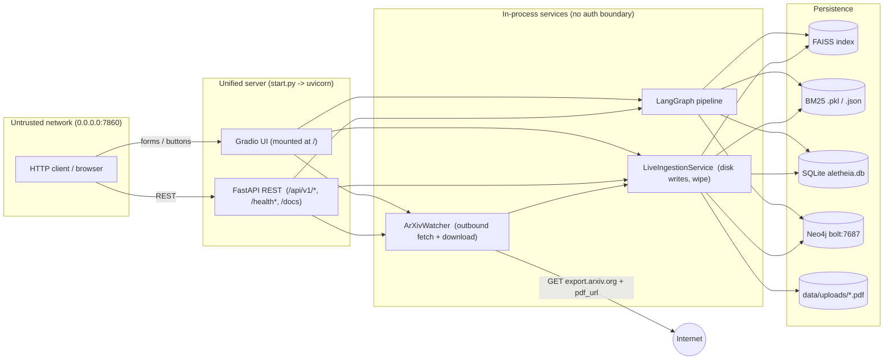

# Project Aletheia (MahoRAGa) — Attack-Surface Map

> **Threat model:** network-exposed. The app binds `0.0.0.0` (`start.py`,
> `docker-compose.yml` publishes `7860`), so any client that can reach the port
> is an untrusted actor. Findings are rated under that assumption.
>
> **Status legend:** 🔴 Open · 🟡 Mitigated (partial / in-progress) · 🟢 Resolved · ⚪ Not applicable
>
> This document is the source-of-truth inventory produced during the security
> pass. Each remediation task updates the status column of the relevant finding.

---

## 1. Request-flow & trust boundaries



**Key observation:** the Gradio UI and the REST API are two independent front
doors onto the *same* service objects. The UI's ingest/wipe/arxiv buttons call
`ingestion_service` and `arxiv_watcher` directly — they do **not** pass through
the REST routes. Any auth placed only on REST therefore leaves the destructive
paths reachable through the mounted UI at `/`.

---

## 2. Entry-point inventory

### 2.1 HTTP routes — FastAPI (`backend/app.py`)

| Method | Path | Handler | Auth today | Sensitivity |
|---|---|---|---|---|
| GET | `/health` | `health_check` | none | read |
| GET | `/health/live` | `liveness` | none | read |
| GET | `/health/ready` | `readiness` | none | read |
| POST | `/api/v1/query` | `execute_query` | none | read-ish (runs pipeline; concurrency-bounded) |
| GET | `/api/v1/sessions` | `list_sessions` | none | read |
| POST | `/api/v1/sessions` | `create_session` | none | **write** |
| GET | `/api/v1/sessions/{id}` | `get_session_detail` | none | read (IDOR: id is user-supplied) |
| DELETE | `/api/v1/sessions/{id}` | `delete_session` | none | **write/destructive** |
| POST | `/api/v1/ingest` | `upload_and_ingest_pdfs` | none | **write** (file upload) |
| GET | `/api/v1/corpus` | `get_corpus_catalog` | none | read |
| POST | `/api/v1/corpus/wipe` | `wipe_corpus` | none | **destructive** (deletes everything) |
| GET | `/api/v1/corpus/health` | `corpus_health` | none | read |
| POST | `/api/v1/corpus/retry-failed` | `retry_failed_docs` | none | **write** |
| GET | `/api/v1/corpus/document/{doc_id}` | `get_corpus_document` | none | read |
| GET | `/api/v1/graph` | `get_graph_topology` | none | read (reads Neo4j) |
| POST | `/api/v1/watcher/sync` | `sync_arxiv_papers` | none | **write + outbound fetch** |
| GET | `/api/v1/metrics` | `get_observability_metrics` | none | read |
| GET | `/api/v1/metrics/traces` | `get_recent_traces` | none | read |
| GET | `/api/v1/metrics/summary` | `get_metrics_summary` | none | read |
| POST | `/api/v1/evaluate` | `run_evaluation_benchmark` | none | **write (expensive)** |
| GET | `/docs`, `/redoc` | FastAPI OpenAPI | none | info disclosure |
| * | `/` (+ Gradio internals) | mounted Gradio app | none | UI front door |

### 2.2 Orphaned / forgotten route

- **`execute_query_stream`** — `backend/app.py` ~line 383. A complete
  Server-Sent-Events streaming handler (documented "Feature 4.1"), but the
  `async def` has **no `@app.post` decorator above it**: `execute_query` ends at
  `sem.release()` (~line 382) and `execute_query_stream` immediately follows
  undecorated. It is never registered on the app and is unreachable dead code.
  Resolution tracked in remediation Task 9.

### 2.3 Forms / input fields — Gradio UI (`ui/app.py`)

| Component | Type | Feeds | Notes |
|---|---|---|---|
| `query_input` | Textbox (free text) | `stream_query_pipeline` → LangGraph | primary query entry |
| `arxiv_query` | Textbox (free text) | `run_arxiv_sync` → `arxiv_watcher.fetch_and_ingest` | raw keywords to arXiv API |
| `arxiv_count` | Slider 1–5 | `run_arxiv_sync` | bounded |
| `file_uploader` | File (multi, `.pdf`) | `run_live_ingest` → `ingestion_service.ingest_files` | main file entry |
| `llm_provider` / `local_model` | Radio / Dropdown | **mutates global `settings`** at request time | shared mutable state across users |
| `evidence_threshold` / `max_compression_ratio` | Sliders | mutates global `settings` | shared mutable state |
| `enable_external_search` | Checkbox | pipeline flag | — |
| `submit` / `clear` / `ingest` / `wipe` / `arxiv` | Buttons | respective handlers | `wipe` is destructive, no confirm dialog |

> **Shared-state note:** `stream_query_pipeline` writes user slider/dropdown
> values into the process-wide `settings` singleton. Under concurrent users this
> is a correctness/isolation defect (one user's settings bleed into another's
> in-flight query), not only a security concern. Flagged for awareness.

### 2.4 Background / autonomous calls

- **ArXiv watcher** (`agents/arxiv_watcher.py`): reachable via the UI button and
  `POST /api/v1/watcher/sync`. It `GET`s `export.arxiv.org/api/query`, parses the
  Atom XML, then downloads each entry's `pdf_url` with `follow_redirects=True`.
  The download URL originates from fetched XML content; the only guards are a
  `%PDF` magic-byte check and a `len > 100` size check. → SSRF surface (Finding F7).
- **No in-process scheduler/timer.** Despite the "Daily Watcher" name, there is
  no cron/background thread; the agent only runs on demand. So there is no
  unchecked timer-driven background call to exploit.

---

## 3. Findings

| ID | Finding | Severity | Location | Status |
|---|---|---|---|---|
| F1 | No authentication on any route; destructive ops (`corpus/wipe`, `sessions` delete, `watcher/sync`, `evaluate`, `ingest`) fully open | **Critical** | `backend/app.py` (all routes) | 🟢 Resolved — scoped bearer-token auth (`backend/auth.py`, `require_write_auth`) on all write/destructive routes; reads open; fails closed when exposed without a key. |
| F2 | Server binds `0.0.0.0` by default | High | `start.py`, `docker-compose.yml` | 🟢 Resolved — bind host configurable via `WEB_UI_HOST`/`--host`, defaults to `127.0.0.1`; non-loopback bind logs an exposure warning. |
| F3 | Weak default secrets shipped (`NEO4J_PASSWORD=password`, `ANTHROPIC_AUTH_TOKEN=freecc`); hardcoded in compose | High | `.env.example`, `docker-compose.yml` | 🟢 Resolved — `.env.example` uses `CHANGE_ME`; compose reads `${NEO4J_PASSWORD:?}`/`${ALETHEIA_API_KEY:?}`; startup warns on weak secrets when exposed. |
| F4 | Stored-XSS: untrusted retrieved chunk text & Neo4j triples rendered unescaped in `gr.Markdown` | High | `ui/app.py` `format_faiss/bm25/external/neo4j_markdown`, `render_evidence_breakdown_html` | 🟢 Resolved — all untrusted chunk/triple/source-map text now `html.escape`d. |
| F5 | PDF upload has no size/content limit (only `.pdf` suffix check) | Medium | `backend/app.py` `upload_and_ingest_pdfs`, `ingestion/service.py` `ingest_files` | 🟢 Resolved — `%PDF` magic-byte + `max_upload_bytes` size check in the route and the service; basename-only staging asserted. |
| F6 | Orphaned/unregistered SSE streaming route (dead code or forgotten endpoint) | Low | `backend/app.py` ~L383 `execute_query_stream` | 🟢 Resolved — registered as `POST /api/v1/query/stream`. |
| F7 | SSRF: arXiv watcher downloads `pdf_url` taken from fetched XML; host/scheme unvalidated | Medium | `agents/arxiv_watcher.py` `fetch_and_ingest` | 🟢 Resolved — `_is_allowed_pdf_url` allow-list (https + arxiv hosts), no auto-redirects, 50 MB cap. |
| F8 | `POST /api/v1/corpus/wipe` runs `MATCH (n) DETACH DELETE n` + clears `data/uploads/` unauthenticated (impact of F1) | Critical | `ingestion/service.py` `wipe_all` | 🟢 Resolved — wipe route now behind `require_write_auth`. |
| F9 | Session detail/delete trust a user-supplied `session_id` with no ownership check (IDOR) | Medium | `backend/app.py` `get_session_detail`, `delete_session` | 🟡 Mitigated — `DELETE` now requires auth; single-tenant model has no per-user ownership, so read-by-id remains by design. |
| F10 | Global `settings` mutated per-request from UI controls — cross-user state bleed | Medium | `ui/app.py` `stream_query_pipeline` | 🟡 Documented — correctness/isolation defect under concurrency. With UI gating (Task 10) the UI is single-operator; a full fix means threading per-request overrides through pipeline state instead of the global singleton (follow-up). |
| F11 | OpenAPI docs (`/docs`, `/redoc`) exposed to untrusted clients | Low | `backend/app.py` app config | 🟢 Resolved — `settings.expose_api_docs` gates `/docs`, `/redoc`, `/openapi.json`. |
| — | BM25 index deserialization via `pickle` | — | `memory/sparse_store.py` | 🟢 Already mitigated (JSON format; legacy pickle only as fallback — in-code "Issue 15"). Regression guard added in Task 11. |
| — | CORS wildcard with credentials | — | `backend/app.py` CORS middleware | 🟢 Handled well: credentials disabled whenever origins are `*`. |
| — | Path traversal via uploaded filename | — | `ingestion/service.py` | 🟡 Largely mitigated by `Path.name` (basename only); hardened + asserted in Task 7. |

---

## 4. Remediation order (prioritized)

1. **F1 / F8 / F9 — scoped authentication** (reads open, writes/destructive gated). Biggest blast-radius reduction.
2. **F2 / F3 — network & secrets hardening** (default loopback bind; remove shipped secrets; startup warning).
3. **F4 — escape untrusted content** in UI render helpers.
4. **F5 — upload size/content limits.**
5. **F7 — arXiv download host/scheme/size validation (SSRF).**
6. **F6 — resolve the orphaned streaming route** (register as `/api/v1/query/stream` or delete).
7. **UI gating** — optional Gradio `auth=` behind an env flag (recommended; see §1).
8. **F10 / F11 — defense-in-depth** (note the settings-bleed; optionally disable docs in exposed mode).
9. **Regression guards** — pickle guard, full suite green, this doc updated to Resolved/Mitigated.

Each item is proven by a test in `tests/security/`.

---

## 5. Security test harness

A live-server harness under `tests/security/` boots the **unified** app (FastAPI
REST + the Gradio UI mounted at `/`, exactly as `start.py` assembles it) in a
background uvicorn thread on an ephemeral loopback port, waits for
`/health/live`, and drives it with `httpx` over real HTTP.

- `tests/security/conftest.py` — the `live_server` / `client` / `auth_headers`
  fixtures and a session-scoped `_security_env` fixture that configures the test
  API key without leaking it into the other suites.
- `tests/security/test_harness_smoke.py` — proves the server boots and the UI
  mounts at `/`.
- `tests/security/test_findings.py` — one executable assertion per finding
  (`F1`..`F11`, plus UI gating), marked `@pytest.mark.security`.
- `tests/security/test_regression_guards.py` — locks in the BM25 JSON-not-pickle
  mitigation (Issue 15).

Run it:

```powershell
# whole security suite
.\.venv\Scripts\python.exe -m pytest tests/security/ -v

# only the finding assertions
.\.venv\Scripts\python.exe -m pytest -m security -v

# full project suite (original + security)
.\.venv\Scripts\python.exe -m pytest -q
```

Current state: **full suite green (90 passed)**; the entire security suite (37
finding/harness tests + 3 regression guards) passes.

---

## 6. Authentication model (as implemented)

- **Scoped bearer token** (`backend/auth.py` → `require_write_auth`), applied to
  write/destructive routes: `POST /api/v1/ingest`, `POST /api/v1/corpus/wipe`,
  `POST /api/v1/corpus/retry-failed`, `POST /api/v1/watcher/sync`,
  `POST /api/v1/evaluate`, `POST /api/v1/sessions`, `DELETE /api/v1/sessions/{id}`.
- **Read endpoints stay open** (health, `/api/v1/query`, GET corpus/graph/
  metrics/sessions).
- **Fail-closed when exposed:** if `ALETHEIA_API_KEY` is unset *and* the bind is
  non-loopback, write routes return `503` — a misconfigured exposed box cannot
  be wiped anonymously. On loopback with no key, writes are allowed for local dev.
- Token comparison uses `secrets.compare_digest` (constant-time).

## 7. UI gating (recommendation → implemented)

The Gradio UI's ingest/wipe/arxiv buttons call the service layer **directly**,
bypassing the REST auth gate — so for a network-exposed deployment the UI must
also be protected. Implemented as optional Gradio basic-auth behind
`ALETHEIA_UI_AUTH_ENABLED` (+ `ALETHEIA_UI_USERNAME`/`ALETHEIA_UI_PASSWORD`),
applied at mount time in `start.py`. Off by default so local dev stays
frictionless; enable it whenever `WEB_UI_HOST` is non-loopback.

## 8. Residual / follow-up items

- **F9 (IDOR by design):** single-tenant model has no per-user ownership;
  session read-by-id is intentional. Revisit if multi-tenant.
- **F10 (settings bleed):** thread per-request overrides through pipeline state
  instead of mutating the global `settings` singleton.
- **BM25 legacy pickle fallback:** `load()` still accepts a legacy pickle file as
  a one-time migration path. For a hardened deployment, delete legacy `.pkl`
  indexes after they have been re-saved as JSON (or remove the fallback branch).
