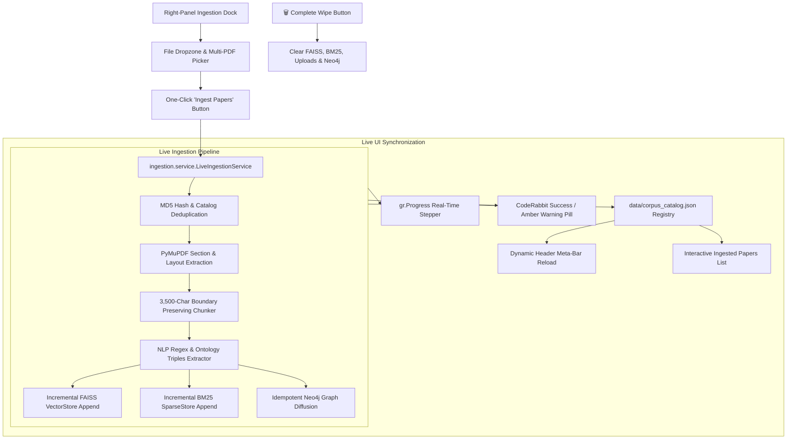

# Milestone 1: Live In-Browser PDF Ingestion Implementation Plan

**Project Aletheia** (Autonomous Multi-Agent AI Literature Research Assistant)  
**Target Milestone**: Milestone 1 — In-Browser PDF Ingestion & Real-Time Corpus Management  
**Date**: 2026-10-14  
**Status**: Ready for User Approval  

---

## 1. Executive Summary

Milestone 1 transforms Project Aletheia from an offline-seeded prototype into a living, interactive research engine. Users can drop or select research PDFs directly within the CodeRabbit web console, trigger an automated ingestion pipeline (layout parsing, semantic chunking, 384-dimensional dense embedding, BM25 tokenization, and Neo4j graph extraction), and immediately query the newly ingested literature without restarting the server.

All architectural decisions have been reviewed and finalized via `/grill-me`.

---

## 2. Architectural Design Tree (Finalized Decisions)



### Decision Matrix

| Dimension | Decision | Rationale |
| :--- | :--- | :--- |
| **UI Placement** | Right Panel Accordion (`📥 Ingest Research Papers`) | Keeps chat and document ingestion side-by-side without context switching. |
| **Corpus Management** | Interactive Corpus List + Complete Wipe | Full visibility of loaded papers (title, pages, chunks, timestamp) with clean slate option. |
| **Storage & Dedup** | `data/uploads/` + MD5 `data/corpus_catalog.json` | Persistent storage across restarts; prevents duplicate vector indexing. |
| **Trigger & Progress** | One-Click Button with `gr.Progress()` | Explicit user intent; granular progress (Parsing -> Chunking -> Embedding -> Indexing). |
| **Reset Action** | Complete Wipe (0 documents) | Total blank-slate reset of FAISS, BM25, uploads, and Neo4j for clean testing. |
| **Neo4j Offline** | Graceful Amber Warning | Ingests FAISS & BM25 uninterrupted; alerts user Neo4j triples were skipped. |

---

## 3. Component Breakdown & Implementation Specs

### 3.1. Ingestion Service (`ingestion/service.py`)

A clean, modular service layer bridging the UI and the underlying memory stores:

```python
class LiveIngestionService:
    def __init__(self, data_dir: str = "data", uploads_dir: str = "data/uploads"):
        ...
    
    def ingest_files(
        self, 
        file_paths: List[str], 
        progress_cb: Optional[Callable[[float, str], None]] = None
    ) -> IngestionResult:
        """
        1. Validates and computes MD5 hash of each uploaded PDF.
        2. Skips duplicates already registered in corpus_catalog.json.
        3. Copies valid PDFs into data/uploads/.
        4. Calls parser.parse_pdf() -> chunker.chunk_document() -> extractor.extract_knowledge().
        5. Appends vectors to VectorStore(index_path, metadata_path) via store.add_chunks().
        6. Appends documents to SparseStore(index_path, metadata_path) via store.add_documents().
        7. Attempts Neo4j upserts with try/except fallback.
        8. Updates and persists data/corpus_catalog.json.
        """

    def get_catalog(self) -> Dict[str, Any]:
        """Returns catalog metadata: documents list, total_docs, total_chunks."""

    def wipe_all(self) -> WipeResult:
        """Empties FAISS index, BM25 index, catalog, uploads, and purges Neo4j if reachable."""
```

### 3.2. Corpus Catalog Registry (`data/corpus_catalog.json`)

Stores persistent metadata for all active documents in the system:

```json
{
  "updated_at": "2026-10-14T20:30:00Z",
  "total_documents": 4,
  "total_chunks": 124,
  "documents": [
    {
      "doc_id": "doc_a1b2c3d4",
      "filename": "AttentionRAG.pdf",
      "title": "AttentionRAG: Fast and High-Fidelity Context Compression",
      "authors": ["J. Doe", "A. Smith"],
      "page_count": 14,
      "chunk_count": 31,
      "md5_hash": "e3b0c44298fc1c149afbf4c8996fb92427ae41e4649b934ca495991b7852b855",
      "ingested_at": "2026-10-14T20:35:10Z"
    }
  ]
}
```

### 3.3. UI Additions in `ui/app.py`

1. **Ingestion Accordion** (Right Column, placed above `sources-tabs`):
   - `gr.Accordion("📥 Ingest Research Papers", open=False)`
   - `file_uploader = gr.File(label="Upload Academic Papers (PDF)", file_types=[".pdf"], file_count="multiple")`
   - Action row:
     - `ingest_btn = gr.Button("Ingest Papers into Memory ➔", variant="primary")`
     - `wipe_btn = gr.Button("🗑️ Wipe All Memory", variant="stop", size="sm")`
   - `ingest_status = gr.HTML(...)`: CodeRabbit alert pill showing real-time feedback.
   - `corpus_display = gr.HTML(...)`: Scannable list of loaded papers with badge tags.

2. **Dynamic Header Update**:
   - The header meta item `<div class="cr-meta-item"><span class="cr-pulse-dot"></span> <span>{docs} Papers Ingested ({chunks} Chunks)</span></div>` dynamically refreshes upon ingestion or wipe.

3. **Query Pipeline Integration**:
   - Because `graph/nodes/retriever.py` calls `VectorStore().load_if_exists()` and `SparseStore().load_if_exists()` per query, newly appended chunks are immediately retrievable on the next query turn with zero cache invalidation lag.

---

## 4. Implementation Steps & Validation Plan

### Step 1: Create `ingestion/service.py`
- Implement `LiveIngestionService` with MD5 hashing, duplication guard, and catalog management.
- Implement incremental FAISS vector extension and BM25 corpus rebuilding.
- Implement Neo4j idempotent upsert with offline fallback.
- Implement `wipe_all()` reset routine.

### Step 2: Seed Initial Catalog
- Scan existing `data/faiss_metadata.json` and `data/bm25_metadata.json` to initialize `data/corpus_catalog.json` with the current 3 benchmark papers so existing documents remain accounted for.

### Step 3: Integrate with `ui/app.py`
- Add CodeRabbit-styled Ingestion Dock CSS.
- Wire upload button to `ingest_files` generator with `gr.Progress()`.
- Wire `wipe_btn` to `wipe_all()`.
- Bind UI outputs to update status pill, corpus list HTML, and header meta bar.

### Step 4: Automated Testing Suite (`tests/test_live_ingestion.py`)
- `test_deduplication()`: Ingesting the same file twice returns a notice and skips re-embedding.
- `test_incremental_vector_expansion()`: Chunks increase and prior chunks remain searchable.
- `test_incremental_bm25_expansion()`: Lexical tokens index correctly.
- `test_neo4j_offline_resilience()`: Upload succeeds and returns amber warning if Neo4j is down.
- `test_complete_wipe()`: Empties index files and returns 0 documents.
- Run complete test suite (`pytest`) to verify all 28 existing tests + new tests pass at 100%.

---

## 5. Definition of Done
1. Users can upload any PDF paper in the UI and see step-by-step progress.
2. Ingested papers appear in the Interactive Corpus List and header badge immediately.
3. Chatbot queries immediately incorporate evidence from the uploaded paper.
4. Neo4j offline state is handled gracefully without crashing the UI.
5. "Wipe All Memory" clears all stores reliably.
6. 100% test pass rate across the entire test suite.
